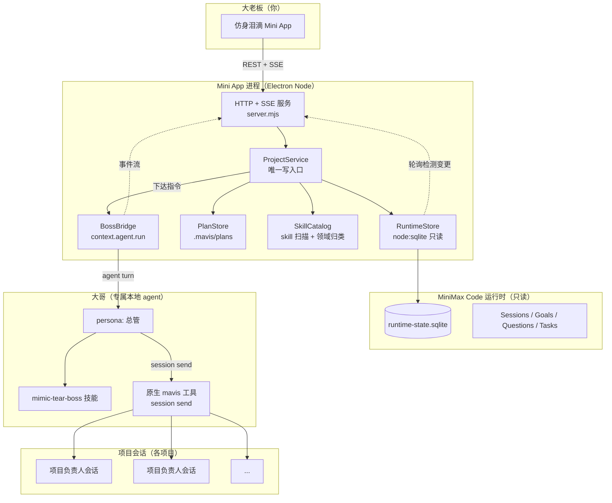

# 仿身泪滴（Mimic Tear）— 多智能体项目管理 Mini App 设计规格

- 日期：2026-10-20
- 形态：MiniMax Code 内的 **Mini App**（DSH 插件形态）
- 状态：待评审

---

## 1. 背景

### 1.1 真实痛点

现有工作流是：我按项目量级开 Goal 模式让 agent 自己迭代，需要细化的我再单独盯盘；日常迭代多、细化少。问题不在"agent 做不出来"，而在两件事：

1. **盯盘成本**：我必须时刻盯着屏幕，逐个会话看进度、看谁卡住了、看有没有在问我问题。
2. **验收成本**：agent 交付后，验收和调试仍然由我亲自做。

### 1.2 身份演变（产品设计的锚点）

```
我（前端开发）
  → 我 + agent 团队（AgentTeam 前后端分工）
  → 我 + 多个项目负责人 agent（每个负责人带自己的团队）
  → 我 = 大老板（开发职责完全分出去，只保留决策）
```

新产品就是这个"大老板"的常设岗位——**「大哥」**。他替我看管全部项目：懂我的需求与决策、会项目管理、能按情况派工、拥有全部开发领域知识。

### 1.3 目标（对应图一"核心目标"）

> 一个能替我开发所有项目的 Agent，让我从��此不再开发；既能做好产品，也能有时间提升自己的各项能力；**主要是代替我开发任何产品，让我能抽离出来做其它事情**。

### 1.4 大哥的 4 项能力要求 → 本设计的落点

| 要求 | 落点 |
| --- | --- |
| 1. 完全理解我的需求、决策 | 「大哥」agent 的 persona + `mimic-tear-boss` 技能中的**决策原则**章节 |
| 2. 熟悉项目管理，按情况安排任务 | `mimic-tear-boss` 技能中的**派工决策树** + **领域→skill 地图** |
| 3. 拥有我的决策力、判断力 | `mimic-tear-boss` 技能中的**决策原则** + **升级/确认边界**（什么必须回问我） |
| 4. 拥有全部开发能力（前后端/全栈/运维/游戏/3D） | **不写进 agent**，而是作为 257 个已安装 skill 的**知识索引**——大哥据此判断"这个任务该派给谁、用什么技术栈" |

> 需求 4 明确说明：能力通过 skill 扩展，但**不是让大哥去做**，而是让大哥拥有专业知识以便**安排任务**。因此 Mini App 里的"能力库"页面是**给大哥看的决策依据**，也是给我的可见性。

---

## 2. 关键发现：运行时已经是唯一数据源

这是本设计最重要的结论，**决定了整个架构不引入任何自建状态库**。

MiniMax Code 运行时已经把"盯盘"需要的一切写进了 `~/.minimax/v2/sqlite/runtime-state.sqlite`（545MB，活跃 WAL 库）。

### 2.1 已验证的数据源

| 数据 | 表 / 路径 | 实测规模 | 对应痛点 |
| --- | --- | --- | --- |
| 项目清单 | `local_runtime_projects` | 16 个真实项目 | 我要看所有项目 |
| 团队层级 | `local_runtime_sessions` 的 `parent_session_id` + `purpose` | 164 会话 | 图二的组织树 |
| Goal 模式进度 | `local_runtime_thread_goals` | 8 个 goal | 迭代进度 |
| **待我回答的问题** | `questionnaire_requests` | 16 条（pending/answered/dismissed） | "哪些问我问题尚未回答" |
| 正在跑的任务 | `local_runtime_background_tasks` | 8471 条 | 实时在做什么 |
| 任务级状态机 | `<项目>/.mavis/plans/*.yaml` + `status*.log` | producing/ready/blocked | Goal 内部进度 |
| 知识库 | `~/.agents/skills` + `~/.minimax/skills` + `~/.minimax/.builtin-skills` | 232 + 5 + 20 = 257 | 需求 4 |

### 2.2 读路径（已端到端实测通过）

- **技术**：`node:sqlite` 的 `DatabaseSync`，`readOnly: true`
- **运行环境**：Mini App 的 Node 运行时 = Electron **42.8.0** / Node **v24.18.0**，`node:sqlite` **无需 flag**
- **实测结果**：打开 545MB 活跃 WAL 库耗时 **0ms**；`local_runtime_projects` 返回 16 行真实项目
- **依赖**：零第三方依赖，无需打包 `node_modules`
- **鉴权**：不需要——本地只读

> ⚠️ 边界：`runtime-state.sqlite` **只读**。Mini App 绝不写入运行时数据库（见 §3.3）。

### 2.3 组织树为什么能还原

`local_runtime_sessions` 里：

- `parent_session_id` 非空 → 该会话是另一个会话的子会话
- `purpose` 取值 `local-task:...` / `local-background-task:...` → 该会话是**被派出的团队成员**
- `session_type = 'root'` 且 `parent_session_id` 为空 → **项目负责人**层

即：运行时**已经在记录图二那套层级**，不需要我们另建组织模型。实测 `GenericGameTemplate` 有 15 个会话，构成 root → 多个 worker/verifier 子会话的真实组织树。

---

## 3. 架构

### 3.1 组件总览



### 3.2 四层职责

| 层 | 职责 | 关键约束 |
| --- | --- | --- |
| **Node 运行时** | 读运行时状态、聚合、持久化自己的派工记录、SSE 推送 | 唯一数据出口；不解析 HTML、不做业务判断 |
| **领域服务 ProjectService** | 所有读聚合 + 所有写（派工、确认）的唯一入口 | 单一写路径：校验 → 提交 → 广播 |
| **Client** | 四个页面的呈现与交互 | 无凭据、无 Host 对象、无领域数据写入 |
| **大哥 agent** | 决策与派工 | 通过原生 `mavis` 工具投递，不直接碰数据库 |

### 3.3 写路径的硬约束

> **Mini App 绝不写入 `runtime-state.sqlite`。**

理由：
1. 该库是运行时的活跃 WAL 库，运行时自身持有写入与投影水位（`local_runtime_ledger_watermarks` 等），绕过它直写会造成状态不一致。
2. 交付指令的**正确语义**是"把一条消息投递给一个正在运行的会话"，这属于运行时的投递机制，不是数据行写入。

因此所有写操作走：

```
Client POST /api/dispatch
  → ProjectService.dispatch()      # 校验 + 持久化 dispatch 记录 + 提交
  → BossBridge.run()               # context.agent.run(agent='boss')
  → 大哥 turn 调用原生 mavis 工具 session send
  → 目标项目会话收到指令
  → SSE 广播 dispatch 进度与结果
```

**降级链**（设计内置，验收时实测确认哪级生效）：

1. **首选**：`context.agent.run({ agent: 'boss' })` — 大哥用 `mavis` 工具投递。
2. **降级**：若 boss agent 运行时拿不到 `mavis` 工具，则投递跳改由**主 agent**（`mavis`）执行，boss 仍负责决策与措辞。配置项 `bossAgent` 可切换。

### 3.4 大哥 agent 与技能

| 项 | 值 |
| --- | --- |
| 稳定名 | `boss` |
| 显示名 | 大哥 |
| 载体 | `mavis agent create` 创建的**专属本地 agent**（非主 agent，非 minimax-bot 的 Chief） |
| 人格 | 总管人格：决策原则、汇报纪律、边界意识 |
| 知识 | `mimic-tear-boss` skill：派工决策树、领域→skill 地图、验收标准、升级边界 |

> 选择专属 agent 而非复用主 agent：主 agent 的上下文会被项目事务挤占，"大哥"角色容易漂移；专属 agent 的目录、记忆、技能互相隔离，也便于后续持续扩能。

技能放在 `boss` agent 的配置目录下，由 `mavis` 的技能机制加载，**大哥获得知识而不是负担执行**。

---

## 4. 数据模型（Client 可见的视图模型）

### 4.1 ProjectCard

```ts
type Health = 'active' | 'idle' | 'blocked' | 'error';

interface ProjectCard {
  id: number;                    // project_id
  name: string;                  // 目录名
  path: string;                  // workspace_dir
  sessionCount: number;
  lastActivityAt: number | null; // ms
  health: Health;
  activeSessions: number;        // status = 'started'
  erroredSessions: number;       // error_code IS NOT NULL
  pendingQuestions: number;      // 未答问卷
  goals: GoalSummary[];
  planTasks: PlanTask[];         // 来自 .mavis/plans
}
```

### 4.2 健康度判定（按优先级，先命中先返回）

| 优先级 | 条件 | Health |
| --- | --- | --- |
| 1 | 存在 `error_code IS NOT NULL` 的会话 | `error` |
| 2 | 存在未答问卷，或 goal `status='paused'`，或 plan 任务含 `blocked` | `blocked` |
| 3 | 存在 `status='started'` 的会话，或存在 `running` 的后台任务 | `active` |
| 4 | 其余 | `idle` |

### 4.3 决策收件箱条目

```ts
type InboxKind = 'questionnaire' | 'goal-paused' | 'session-error' | 'plan-blocked';
type Severity = 'high' | 'medium' | 'low';

interface InboxItem {
  id: string;                    // 稳定 ID（用于 ack）
  kind: InboxKind;
  severity: Severity;
  projectId: number;
  projectName: string;
  sessionId: string | null;
  sessionTitle: string | null;
  title: string;
  body: string;                  // 问卷 question / 错误信息 / 目标摘要
  createdAt: number;
  ageMinutes: number;
  acknowledged: boolean;         // 存在 dataDir/acks.json 中
}
```

严重度：`session-error` = high；`questionnaire` = high；`plan-blocked` = high；`goal-paused` = medium。

> **实现修正（2026-10-20）**：初稿列了 `task-failed` 一类。实现时实测运行时已有 428 条历史失败任务，全部列入收件箱会把真正需要你决策的事项淹没，因此**不把后台任务失败纳入收件箱**——只有会话级异常、待答问卷、被阻塞的计划任务和暂停的 Goal 才进入。四类都指向"需要你做点什么"，这才是收件箱的职责。

### 4.4 项目详情：组织树

```ts
interface OrgNode {
  sessionId: string;
  agentName: string;      // mavis / worker / explore / verifier
  title: string;
  status: 'started' | 'idle';
  role: 'lead' | 'member';
  purpose: string | null; // local-task:... / local-background-task:...
  error: string | null;
  children: OrgNode[];
}
```

构建规则：`parent_session_id` 为空且属于该 project → 根节点（`role='lead'`）；否则挂到父节点下（`role='member'`）。孤儿节点（父会话不在本 project）提升为根节点，避免丢数据。

### 4.5 能力库

```ts
interface SkillEntry {
  name: string;          // frontmatter name
  description: string;   // frontmatter description（截断）
  source: 'user' | 'builtin' | 'project';
  domain: string;        // 归类后的领域 key
  path: string;          // SKILL.md 绝对路径
}

interface DomainGroup {
  key: string;
  label: string;
  skills: SkillEntry[];
}
```

归类：内置 `domains.json` 清单按名称前缀/关键词匹配；未命中的按 description 关键词兜底；仍未命中的进 `unmapped` 组。

---

## 5. API

| 方法 | 路径 | 说明 |
| --- | --- | --- |
| GET | `/api/overview` | KPI + 项目卡数组 + 需关注项 |
| GET | `/api/inbox` | 决策收件箱条目（按严重度 + 时间排序） |
| GET | `/api/projects` | 项目卡列表（与 overview 复用同一聚合） |
| GET | `/api/projects/:id` | 项目详情：组织树 + goals + questions + tasks + plan |
| GET | `/api/skills` | 能力库（按领域分组） |
| POST | `/api/dispatch` | 下达指令到项目会话 |
| GET | `/api/dispatch/:id` | 单次派工状态 |
| GET | `/api/stream` | SSE：快照推送 + 派工进度 |

### 5.1 派工请求/响应

```jsonc
// POST /api/dispatch
{ "projectId": 30, "sessionId": "mvs_xxx", "instruction": "把 X 任务排到明天" }
// 200
{ "dispatchId": "dsp_...", "status": "queued" }
```

`sessionId` 可省略：省略时由大哥自行选择该项目下最合适的会话。

### 5.2 SSE 事件

| event | data |
| --- | --- |
| `snapshot` | 完整 overview + inbox（连接时立即推送一次） |
| `update` | 同上，运行时状态变更后推送 |
| `dispatch` | `{ dispatchId, phase: 'running'\|'done'\|'error', text }` |

### 5.3 轮询与推送

Node 侧每 3 秒计算一次**廉价修订号**（`max(updated_at_ms)` + 各表计数 + pending 计数）。修订号变化 → 重新聚合并 `update` 推送。数据量级下（16 项目 / 164 会话）单次聚合 < 50ms，轮询足够，不需要事件溯源。

### 5.4 持久化（`context.dataDir`）

| 文件 | 内容 |
| --- | --- |
| `dispatches.json` | 派工记录：id、项目、指令、大哥 sessionId、状态、时间 |
| `acks.json` | 已确认的收件箱条目 id |
| `boss-session.json` | 大哥会话 id（保持上下文连续） |

遵循 `security-and-state.md`：**先提交，再广播**。广播失败不回滚已提交状态；重连页面读当前快照即可恢复。

---

## 6. 页面设计

遵循 `minimax-code-visual-ui.md` 基线：克制专业、深浅色自适应、中性色板、语义色仅用于状态、卡片 12px 圆角、控件 8px、无渐变无霓虹无 emoji、图标用内联 SVG。

### 6.1 总览看板 `/`

```
┌─ 仿身泪滴 ──────────────────── [KPI 占位] ──────────────────────────┐
│  全部项目 · 运行中 · 待你决策 · 报错   ← 四张 KPI 卡，数值运行时取   │
├─ 需你处理 ────────────────────────────────────────────────────────────┤
│  ● [高] <项目名> — <待答问题摘要>                     [去回答]      │
├─ 项目 ────────────────────────────────────────────────────────────────┤
│  项目名        状态   Goal      会话  待决策  最后活动      操作      │
│  ...           ●运行  2 active  15    1       3 小时前    [详情]    │
└───────────────────────────────────────────────────────────────────────┘
```

> 上图为**线框示意**，其中的项目名与数字均为占位；实际数值由运行时聚合得出，与 §9 验收项 2 的 sqlite 探针结果逐项比对。

- 顶部 KPI 4 张：项目总数 / 运行中 / 待你决策 / 报错
- **需你处理**区置顶，只显示 high+medium 项——这是"不用再盯屏"的核心兑现点
- 项目表按"最后活动"倒序；健康度用色点 + 文字（不靠颜色单独表意）
- 点击项目 → 详情页；点击收件箱项 → 决策收件箱（或直达会话）

### 6.2 决策收件箱 `/inbox`

- 按严重度分组（高 / 中 / 低）
- 每项：项目、标题、正文摘要、等待时长、来源会话
- 操作：`去回答`（在 Host 中打开原会话）/ `下达指令` / `标记已知`
- 顶部有过滤器：项目 / 类型 / 是否已确认

### 6.3 项目详情 `/projects/:id`

- 头部：项目名 + 路径 + 健康度 + KPI
- **组织树**：忠实还原图二——负责人 → 团队成员。每个节点显示运行时**实际记录**的 `agent_name`（`mavis` / `worker` / `explore` / `verifier` / `coder` / `general`）与 `purpose` 派工来源，以及该成员的状态与错误。
  > 注意：运行时**不记录**"架构师/运维/后端/前端"这类职能角色名，因此本版不臆造职能标签。职能维度的映射放在**能力库**（领域 → skill）里，由大哥在做派工决策时使用，而不是写在组织树上。
- **Goal 列表**：objective、状态、token、耗时、上次验收结论
- **计划任务**：来自 `.mavis/plans` 的任务状态机（producing/ready/blocked）
- **待答问题**：该项目下的问卷
- 操作条：`下达指令`（填入项目上下文后派发）

### 6.4 能力库 `/skills`

- 左侧领域导航（UE5 / 3D 建模 / 前端 / 桌面 / 移动 / 后端 / .NET / 游戏 / 项目管理 / 调研文档）
- 右侧该领域的 skill 列表：名称、一句话描述、来源、路径
- 顶部说明这是"大哥的调度依据"，不是给人执行的清单
- 支持搜索

### 6.5 交互与可访问性

- 语义化 HTML（`header`/`nav`/`main`/`section`/`table`）
- 每个可交互元素有可见文字或 `aria-label`，键盘可达，焦点环清晰
- 状态用 `role="status"` / `role="alert"`
- 加载 / 空 / 错误 / 工作中四态都保留页面结构
- `prefers-reduced-motion` 下移除动效
- 不用 emoji、不用远程字体/图片/CDN

---

## 7. 错误与降级

| 情况 | 表现 |
| --- | --- |
| `runtime-state.sqlite` 不存在 | 顶部横幅：未找到运行时状态库 + 期望路径 + 排查建议。**页面结构保留**，其余区块显示空态，**不崩溃** |
| 数据库被运行时独占锁住 | 读失败 → 展示上一次成功聚合的快照 + 标记"数据可能滞后" |
| `node:sqlite` 不可用 | 同上，横幅说明运行时版本需要 Node ≥ 22.5 |
| `.mavis/plans` 缺失 | 项目详情隐藏"计划任务"区块，不报错 |
| skill 目录扫描失败 | 能力库显示已扫描到的部分 + 失败数 |
| 派工失败 | 收件箱/详情页内联错误提示，dispatch 记录标 `error`，**不重试**（避免重复投递） |
| 大哥会话报错 | 同上，错误文本入库可见 |

路径定位：默认 `path.join(os.homedir(), '.minimax/v2/sqlite/runtime-state.sqlite')`，可用环境变量 `MIMIC_RUNTIME_DB` 覆盖。

---

## 8. 大哥的职责边界（写进 persona 与技能）

### 8.1 决策原则（技能正文要点）

1. **先看证据再看结论**：任何项目状态判断必须来自运行时数据，不臆测。
2. **派工前先问三件事**：目标是什么 / 验收标准是什么 / 会不会和现有在跑的任务冲突。
3. **默认用最轻的执行路径**：能在项目内直接做的就不新建 agent；需要并行才拆子会话。
4. **不确定就升级给我**：改需求、删数据、破坏性操作、跨项目资源冲突 → 必须回问我。
5. **汇报纪律**：只报状态变化与需要决策的事，不做流水账。

### 8.2 派工决策树（技能正文要点）

```
任务到达
 ├─ 已有 Goal 在跑同一项目同一目标? → 不新开 Goal，追加到现有
 ├─ 目标是纯问答/调研? → explore
 ├─ 目标是单点实现且无跨文件影响? → worker
 ├─ 目标需要多角色协作(架构/后端/前端/测试)? → 拆子会话，按角色并行
 ├─ 目标涉及验收/审计? → verifier
 └─ 目标需要领域技术栈决策(UE5/Blender/3D/…)? → 先查能力库，选对应 skill 作为技术依据
```

### 8.3 升级边界（技能正文要点）

必须回问大老板：需求变更、破坏性操作、跨项目冲突、需要花费大量 token 的新开 Goal、连续失败 3 次以上。

---

## 9. 验收标准

发布后逐条验证，**每条都要有运行时证据，不接受"看起来对"**：

| # | 验收项 | 判定 |
| --- | --- | --- |
| 1 | `publish` → `inspect` → `open` 成功，`runtime.status = running` | Host 结构化返回 |
| 2 | 总览页项目数与 sqlite 探针一致（当前为 16） | 页面读数 == `select count(*) from local_runtime_projects where workspace_dir is not null and hidden=0` |
| 3 | 收件箱能列出真实的 pending 问卷 / paused goal / 报错会话 | 与 sqlite 逐条对照 |
| 4 | 项目详情能还原出组织树层级（`GenericGameTemplate` 应见 root + 多子会话） | 树形渲染 == `parent_session_id` 关系 |
| 5 | 能力库列出 ≥250 个 skill，归入 ≥8 个领域 | 数量与 `~/.agents/skills` 实际目录数一致 |
| 6 | **一键下达真实可用**：对一个测试会话派发一条指令，目标会话确实收到 | 目标会话消息流中出现该指令 |
| 7 | SSE：另一页面打开时状态变化能自动刷新 | 两页联动观测 |
| 8 | 零第三方依赖（无 `node_modules`），清单通过 Host 校验 | `publish` 成功 + 目录无 node_modules |
| 9 | 无 console 错误、无 401、无内部路径/端口泄露到页面 | Browser console + 网络面板 |
| 10 | 浅色/深色主题均可读，键盘可完成核心操作 | 人工 + 键盘走查 |

未通过项必须如实报告为未验证，不得以"实现无误"代替。

---

## 10. 明确不做（YAGNI）

- 不做鉴权与多用户（单机单用户场景）
- 不做自动验收、自动合并、自动改代码——大哥只**看、只派、只汇报**
- 不做全量消息全文检索（只读尾部与摘要；全文检索应由运行时负责）
- 不自建任务编排引擎——复用已有 Goal 模式
- 不直连 minimax-bot 团队 API——大哥需要时通过 minimax-bot MCP 自行调用
- 不做云端同步、不做历史归档、不做通知系统

---

## 11. 实施步骤

1. `miniapp.init` 初始化 `miniapps/mimic-tear` 工作区包
2. Node 运行时：`runtime-store` / `plan-store` / `skill-catalog` / `project-service` / `boss-bridge` / `server`
3. Client：四个视图 + SSE 客户端 + 样式
4. `publish` → `inspect` → `open` → Browser 验收
5. 创建 `boss` agent + `mimic-tear-boss` 技能（需大老板明确批准后执行）
6. 实测派活链路，必要时启用 §3.3 降级链

---

## 12. 待确认

- 无。四个关键决策（大哥权限边界 / 大哥载体 / 页面范围 / 视觉风格）已于 2026-10-20 确认。
